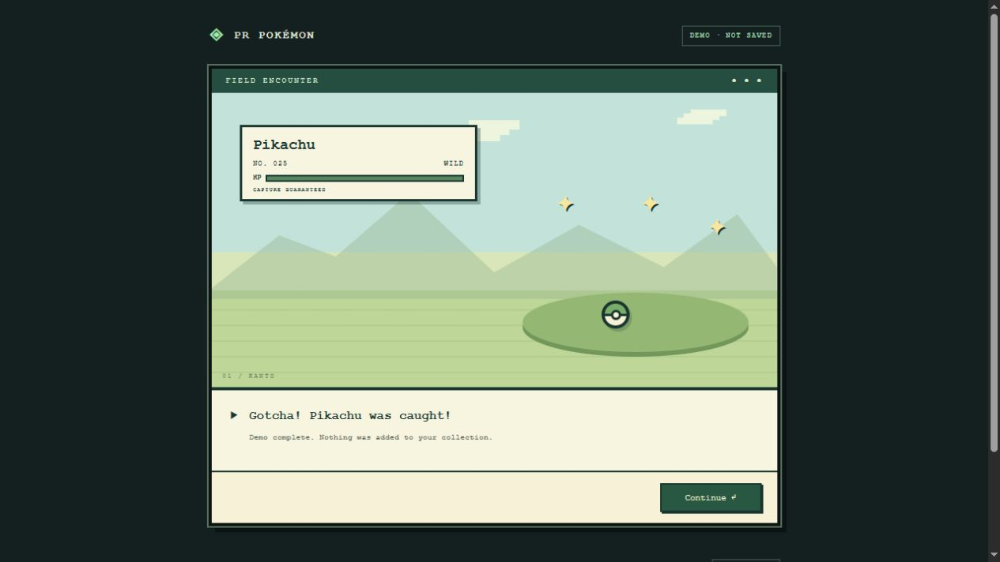
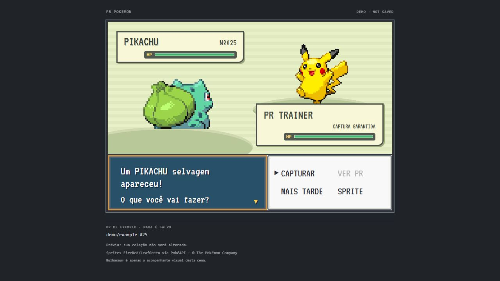

# PR Pokémon Finder

Turn your GitHub pull requests into Pokémon encounters inside Visual Studio Code.

**Status: pre-release / playable capture prototype.** US-01 through US-06 are implemented:
native sign-in, API access, cross-repository discovery, and automatic polling with
a canonical PR index and idempotent automatic captures. Each eligible new PR now
receives a deterministic species number, persisted before any presentation.
The first visual flow (US-09/16/19/27/28) now presents a name/sprite, retro encounter,
guaranteed capture, and confirmation. There is no Marketplace release yet, and
the account-global Pokédex is available from its status-bar button or **Open Pokédex**.

## Test your first capture

Today's implementation stack is documented per story, starting with
[US 10: deterministic assignments](docs/us-10-deterministic-assignment.md).
Screenshots below use sanitized demo data.

Persistence guarantees and recovery are described in
[US 13](docs/us-13-local-persistence.md).

[US 14](docs/us-14-global-collection.md) provides the account-global, offline
collection read model. Run **Show Local Collection Status** to inspect it.

[US 15](docs/us-15-direct-github.md) documents direct GitHub access and the
**Show Network and Privacy Policy** diagnostic command.

[US 16](docs/us-16-presentation-queue.md) covers serial presentation and explicit
resume without overlapping scenes.

See [installation and VSIX verification](docs/us-18-installation.md) (US 18).
Version **0.0.2** is a local pre-release; no Marketplace publication is implied.

[US 23](docs/us-23-multiple-repositories.md): **Browse Repository Captures**
opens rewards by source across repositories, without configuring any remotes.

[US 21](docs/us-21-pokedex.md) adds the visual Pokédex, source details, offline
fallback and **Preview Pokédex** (no login or collection changes).

1. Install the generated VSIX or run this checkout with **F5**.
2. Run **PR Pokémon Finder: Preview Capture Animation** to see a Pikachu demo
   immediately, without GitHub sign-in or changes to the collection.
3. Sign in and let the first synchronization finish (historical PRs do not grant rewards).
4. Open a **new** PR authored by that account. Wait for polling or run **Check for
   New Pull Requests Now**. Search indexing may delay detection.
5. The FireRed-style scene opens beside the editor and **waits for you**. The Pokémon
   stays visible until you select **CAPTURAR**, which starts throw → shakes → success.
   Click **CONTINUAR** afterward to advance to the next encounter.

Captures are saved **before** animation. Skip/close never loses a Pokémon; merge
is not required. Closing before the capture completes or choosing **MAIS TARDE**
leaves the encounter pending; it is deferred for this window's session so it does
not interrupt you again on every poll. Use **Show Pending Capture Animations** to
resume. Only completing the capture and dismissing its result acknowledges it.
Switching accounts/scopes or shutting down before acknowledgement also keeps it recoverable.

Actual FireRed/LeafGreen front/back sprites require internet access to the public PokeAPI/sprites host; no GitHub token
or PR metadata is sent. A failed image load shows a clearly marked fallback,
not a failed capture. Use **SPRITE** or try again when connected.
**Presentation: Enabled** controls automatic scenes, **Presentation: Remote Artwork**
controls external image requests, and **Presentation: Reduced Motion** skips
movement **after** you select CAPTURAR; it never skips the decision. OS/VS Code reduced-motion preferences are respected too.
With automatic scenes off, use **Show Pending Capture Animations** manually.



### Extension gallery

The encounter screenshot below was captured from the real production renderer
using sanitized demo data. It shows the manual CAPTURAR choice and optional
FireRed/LeafGreen sprites, not a new reward granted to your account.
The result screenshot above has artwork disabled.



Pokémon artwork and trademarks are not covered by the project's MIT license;
see [third-party notices](THIRD_PARTY_NOTICES.md).

## Try GitHub authentication

After the setup below, open the checkout folder in VS Code and press **F5** to
launch an Extension Development Host. Click **PR Pokémon: Sign in** in the status
bar, or run **PR Pokémon Finder: Sign in to GitHub** from the Command Palette.
The native GitHub provider handles browser authentication and consent.

By default, the extension requests `read:user` for account identity and public
PR access. Optional private access requires additional consent, described below.
The extension does not store tokens. On restart, it silently asks VS Code for the
existing authorized session. Use the VS Code **Accounts** menu to sign out or
revoke this extension's access; the status indicator updates accordingly.
Use **PR Pokémon Finder: Show Authentication Status** to inspect the current state.
Canceled sign-in can be retried without reloading the extension.

## Try GitHub API access

After signing in, run **PR Pokémon Finder: Check GitHub API Connection** to verify
the session against GitHub. Run **PR Pokémon Finder: Inspect Pull Request** and
paste a public PR URL, for example
`https://github.com/john-tavares/pr-pokemon-finder/pull/1`, to see its title and
open/closed/merged status. Requests are authenticated HTTPS GETs directly to
GitHub; they do not modify PRs or start monitoring.

The token is obtained silently from VS Code for each request and never persisted
by the extension. If GitHub rejects it, the extension marks the session disconnected
and offers a new native login. Network failures and rate limits show actionable
messages; rate-limited requests pause until the cooldown ends.

Polling starts automatically after an authorized session is restored. Login and
private-scope consent are never prompted automatically.

## Discover your pull requests

Run **PR Pokémon Finder: Discover My Pull Requests** to find PRs authored by your
authenticated GitHub account across repositories, including repositories not open
in VS Code. No Git remote or per-repository configuration is required. Select a PR
to inspect its metadata and optionally open it on GitHub.

Results include owner, repository, PR number, URL, open/closed state, and creation,
update, and closure dates. Discovery is an explicit snapshot, not background
monitoring or durable storage. Search results are paginated up to GitHub's
1,000-result limit. Partial, shifting, or capped results show a warning and must not
be interpreted as a complete history. GitHub search indexing and access restrictions
can also affect results. Merge and closure are metadata, not reward events.

Public repositories are the default. To include private repositories, run
**PR Pokémon Finder: Enable Private Repository Access**. The command explains
GitHub's broad `repo` OAuth scope, then opens native consent; this scope permits
both read and write access, although this extension only makes read requests.
Only successful consent enables the global private-discovery preference. Account
and organization/SSO policies still apply.

To return to public-only discovery, disable **PR Pokémon Finder: Include Private
Repositories** in Settings. This does not revoke existing OAuth permissions;
manage those through VS Code Accounts/GitHub. Tokens remain managed by VS Code.

## Automatic monitoring

Once connected, the extension checks authored PRs immediately and then waits
60 seconds after each completed check before running again. It works in an empty
window and across repositories. Use **Show Monitoring Status**, **Check for New
Pull Requests Now**, and **Show Pending Capture Presentations** from the Command Palette.

The first successful query in each access mode establishes its starting reference: historical
PRs are recorded as known, and unseen PRs created since that query began enter
a capture ledger. This includes PRs closed between checks: opening the PR is the
reward event, not merging it. The account-scoped index, captures, and presentation
queue survive restarts in the extension's local global storage. API
errors and incomplete search results never erase known records. Partial results
remain visibly flagged; search indexing can delay detection or miss capped results.

Polling pauses on logout, rejected credentials, disabling the feature, or extension
shutdown. It never starts an interactive login in the background. Rate-limit
responses extend the next delay. Change **Polling: Enabled** or **Polling: Interval
Seconds** in PR Pokémon Finder Settings (60–3600 seconds).

The initial assignment uses species numbers 1–151 with a versioned deterministic
seed. There is no rarity or Shiny selection yet. **Show Pending Capture
Presentations** lists the species number and originating PR; selecting it opens
GitHub, not an animation, and does not mark the presentation as shown. Automatic
scenes and **Show Pending Capture Animations** are the actual visual presenter.
Private-mode captures are hidden in public-only mode but are not deleted.

Local writes are serialized across monitoring windows with an exclusive file lock
and atomic snapshot replacement. A busy writer retries on its next poll without
overwriting another window. A process crash can leave a lock requiring manual
recovery; see [storage troubleshooting](docs/development.md#storage-recovery).
Do not run older extension builds against the same profile after migrating.

## Planned experience

- Discover your pull requests across repositories, independently of the open workspace.
- Encounter a Pokémon when a new pull request is discovered.
- Choose CAPTURAR to play the guaranteed capture, independently of later merge or closure; no fleeing or capture failure.
- Present a retro pixel-art encounter followed by a guaranteed capture animation as a core feature.
- Keep captures and a shared Pokédex locally across workspaces.
- Add collection screens, rare encounters, opening-PR streaks, and achievements.

The planned implementation uses TypeScript, native VS Code GitHub authentication,
direct GitHub API requests, polling, and local extension storage. It requires no
project-hosted backend. Monitoring will run while the extension is active; it is
not an always-on service when VS Code is closed.

## Start developing

Install Node.js 24 and pnpm 11.25.0. To install the pinned package manager with npm:

```sh
npm install --global pnpm@11.25.0
git clone https://github.com/john-tavares/pr-pokemon-finder.git
cd pr-pokemon-finder
pnpm install --frozen-lockfile
pnpm check
```

Development requires Node.js 24; the extension supports desktop VS Code 1.95.0 or
newer. Run `pnpm build` to compile TypeScript, `pnpm test:extension` for an isolated
Extension Host smoke test, or `pnpm package` to produce
`dist/pr-pokemon-finder.vsix`. Install that file using **Extensions: Install from
VSIX...**. It contains authentication, API lookup, discovery, polling, and the capture ledger.

## Contribute

Start with [CONTRIBUTING.md](CONTRIBUTING.md). Issues and documentation improvements
are welcome, including contributions from first-time contributors.

| Guide                                 | What it covers                                                   |
| ------------------------------------- | ---------------------------------------------------------------- |
| [Development](docs/development.md)    | Setup, commands, branches, forks, worktrees, and troubleshooting |
| [Architecture](docs/architecture.md)  | Planned components, data boundaries, and open design decisions   |
| [Roadmap](docs/roadmap.md)            | Product scope and public requirement tracking                    |
| [Maintainers](docs/maintainers.md)    | Review, repository settings, releases, and automation            |
| [Code of conduct](CODE_OF_CONDUCT.md) | Community expectations and reporting                             |
| [Security](SECURITY.md)               | Private vulnerability reporting and support policy               |

## License and assets

The repository's original code and documentation are licensed under the
[MIT License](LICENSE). Contributors must identify the source and license of any
third-party material they add.

Pokémon names, characters, and artwork belong to their respective owners. This is
an independent fan project with no affiliation or endorsement. The MIT license
does not grant rights to third-party trademarks or artwork. No Pokémon sprites
are bundled in the repository or VSIX. Runtime image sources, rights caveats,
network behavior, and original UI attribution are documented in
[Third-party notices](THIRD_PARTY_NOTICES.md). Rights review remains a release requirement.
