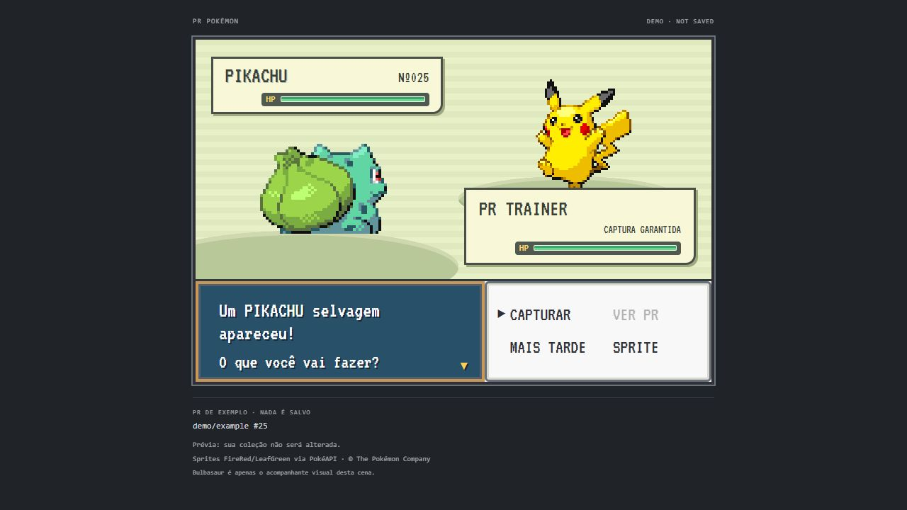

# US 19 — Encounter, capture and Pokédex handoff

The encounter visibly waits for **CAPTURAR**, then plays the existing retro
throw → shakes → success animation. No merge, combat or additional reward
confirmation is required. The reward was already saved before the scene opened;
the button controls presentation, not eligibility or storage.

The result now offers **POKéDEX** as well as **CONTINUAR**. Pokédex access is enabled
only after capture completion, including skip/reduced-motion completion. Opening
it closes and acknowledges the completed scene, then opens the real collection.
In demo mode it opens the synthetic Pokédex and cannot mutate real rewards.
Native handlers reject premature handoff messages.

Early close, Escape or MAIS TARDE keeps the reward and defers its pending scene.
The source name, repository and PR number remain visible. Keyboard buttons,
polite status announcements, focus on CONTINUAR after completion, and reduced
motion preserve the explicit user choice.

Collection reads now use the last atomically committed ledger without taking a
writer lock, so opening/refreshing the Pokédex cannot block scene acknowledgement.

Validation: manual choice, animation order, early close, reduced motion, skip,
completion-only Pokédex navigation, concurrent snapshot reads, renderer security
and the real VS Code Extension Host in `pnpm check` / `pnpm test:extension`.

## Extension screenshots

These are production-renderer screenshots with sanitized demo data, captured
before the completion-only Pokédex button was added. No real account data is shown.

