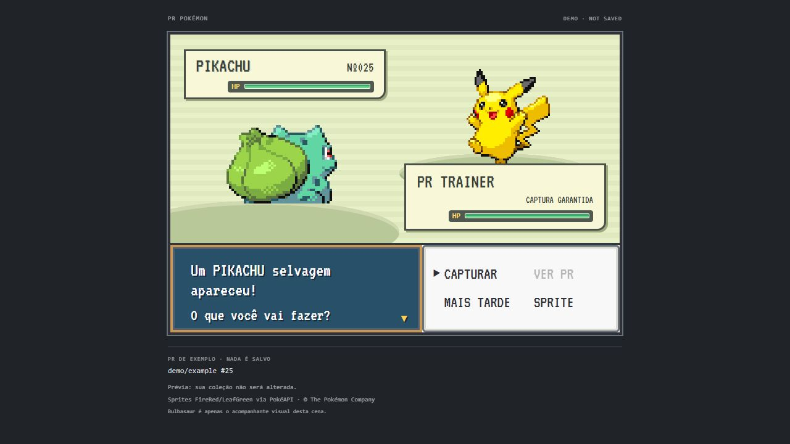

# US 21 — Open the Pokédex

Run **PR Pokémon Finder: Open Pokédex** or click **Pokédex** in the status bar.
Every saved reward is listed immediately, even if its scene is pending or its PR
has since been closed/merged. Repeated species remain separate PR memories.

Choose a card to inspect species, source repository/PR, capture timestamp (UTC),
presentation status and the PR state observed at detection. That last field is
historical, not a claim about the current GitHub state. **ABRIR PR NO GITHUB**
opens the validated ledger URL; the webview cannot supply arbitrary URLs.
This supplies the source-detail navigation required by US 21 without adding
unscheduled filters, rarity tiers or statistics.

The FireRed-inspired red device layout is original HTML/CSS and uses the shared
VT323 font and optional FireRed/LeafGreen sprites. Missing/disabled images never
hide names or source records. Only the visible page (24 records) loads artwork,
with at most four workers. Webviews cannot connect to the network; the native
loader fetches credential-free sprites from the fixed public host.

Signed-out, unverified account, loading, empty and storage-error states are
explicit. Account/scope changes immediately replace incompatible content. Refresh
reads local storage, not GitHub; polling remains a separate control.

## Try without GitHub

**Preview Pokédex** uses sanitized fixtures and cannot grant or mutate rewards.
After `pnpm build`, run `node scripts/preview-capture.mjs` and open
`http://127.0.0.1:4173/pokedex` for the same production renderer in a browser.
Use `--offline` to prevent external artwork requests. This server binds only
loopback and never reads VS Code account data.

Validation: renderer escaping/CSP, all collection states, paging, exact-key
selection and client message shapes in unit tests. The real isolated VS Code
Extension Host opens/closes both demo and signed-out Pokédex tabs and confirms
that previews leave the real collection empty.

## Extension screenshots

The shared encounter is shown below. The gallery records which renderer and
fixture each screenshot uses; it does not portray a mockup as a running feature.

